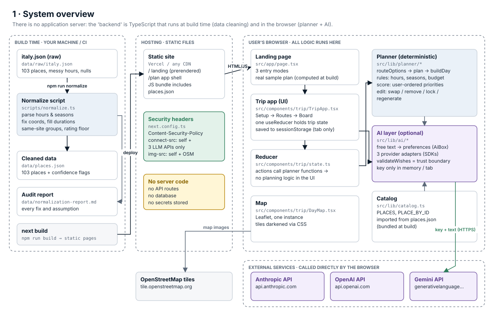
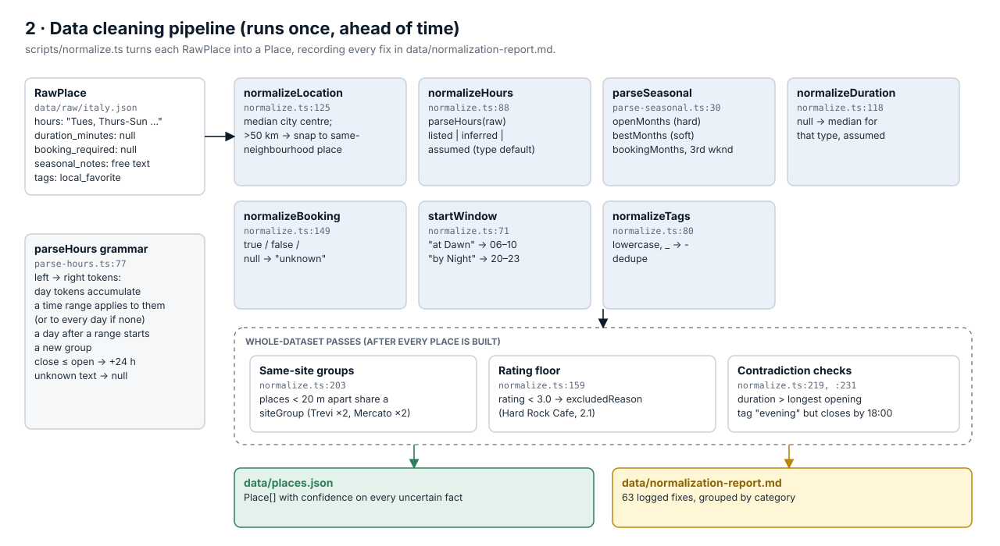
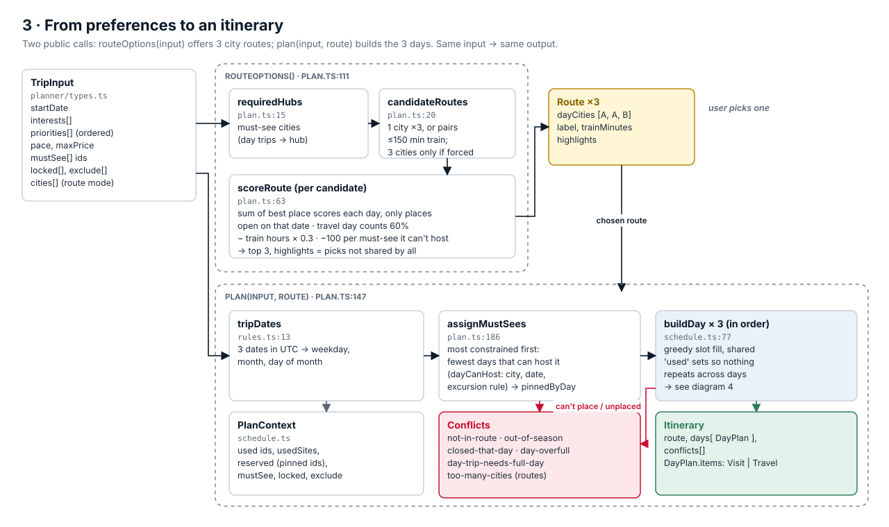
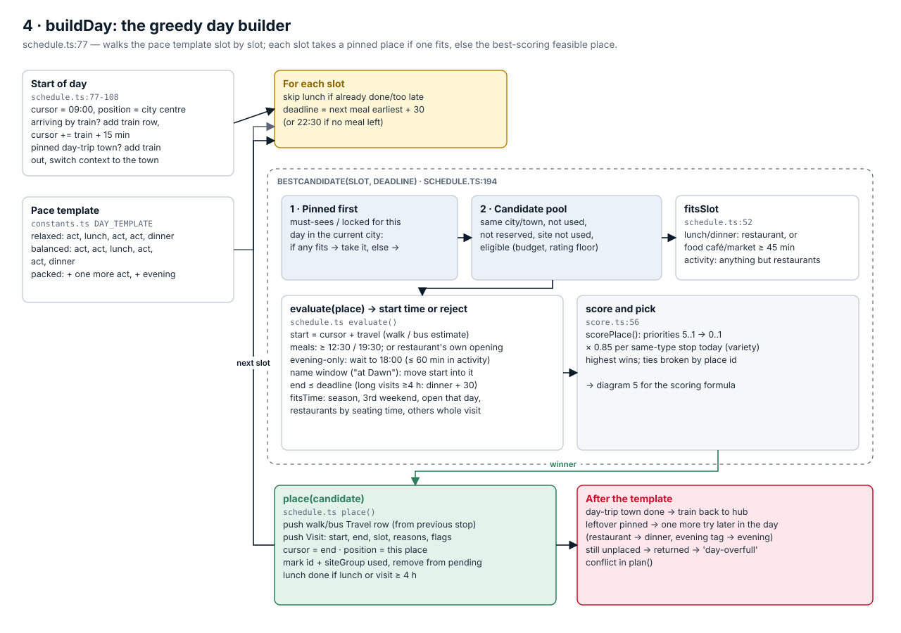
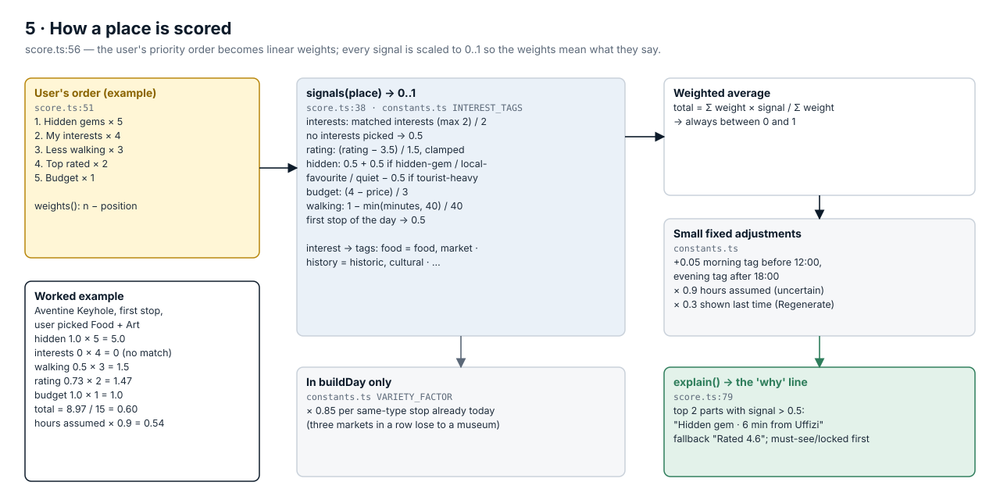
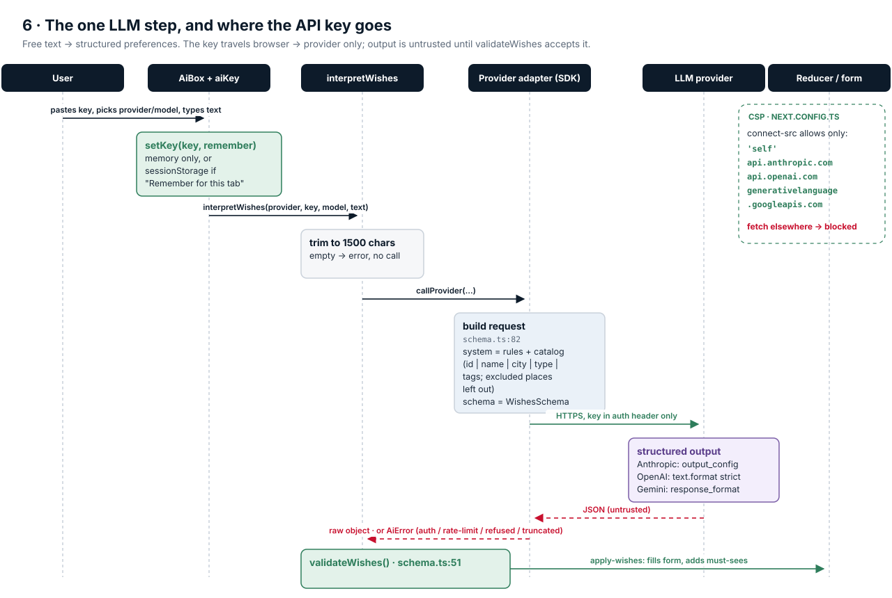
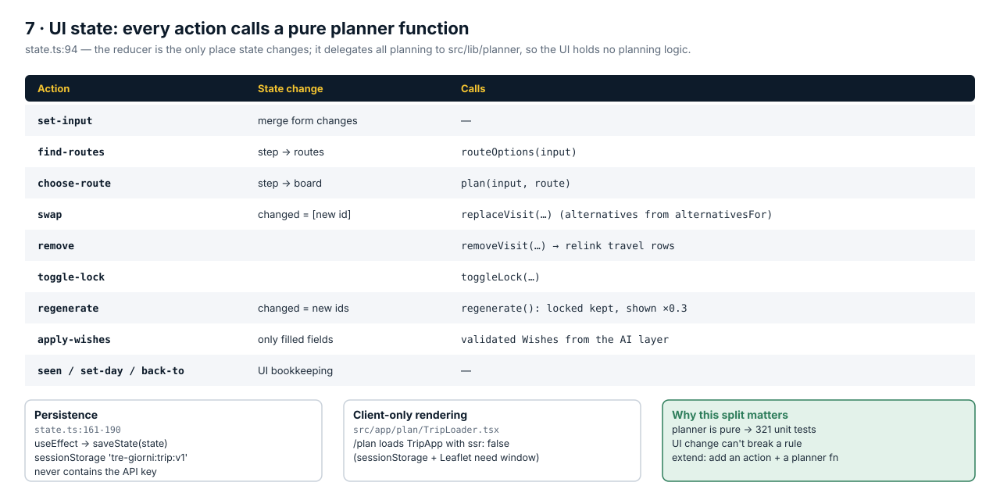

# Tre Giorni: how the code works

A guide to the "backend" of the 3-day Italy planner: what each part does, where it lives, and why it was built that way. File references use `path:line` and match the code as committed.

> **The one-sentence version:** a build-time script cleans the messy dataset once. In the browser, a **deterministic** planner turns ordered user priorities into a feasible 3-day schedule. An **optional** LLM step (with the user's own key, called straight from the browser) only converts free text into the same form fields a person could fill in by hand.

---

## Contents

1. [The big picture](#1-the-big-picture)
2. [Data cleaning (build time)](#2-data-cleaning-build-time)
3. [The data model](#3-the-data-model)
4. [Planning: preferences → itinerary](#4-planning-preferences--itinerary)
5. [Building one day](#5-building-one-day)
6. [Scoring and explanations](#6-scoring-and-explanations)
7. [Editing a plan](#7-editing-a-plan)
8. [The AI step and API-key security](#8-the-ai-step-and-api-key-security)
9. [UI state and persistence](#9-ui-state-and-persistence)
10. [End-to-end workflows (traces)](#10-end-to-end-workflows-traces)
11. [Testing strategy](#11-testing-strategy)
12. [How to extend it (interview playbook)](#12-how-to-extend-it-interview-playbook)
13. [Known limitations](#13-known-limitations)
14. [File map](#14-file-map)

---

## 1. The big picture



**There is no application server.** "Backend" here means two things:

| Where it runs | What | Files |
|---|---|---|
| **Build time** (your machine / CI) | Clean `italy.json` once into `places.json`, plus an audit report | `scripts/normalize.ts`, `src/lib/parse-hours.ts`, `src/lib/parse-seasonal.ts` |
| **Browser** | Plan, score, edit, validate AI output | `src/lib/planner/*`, `src/lib/ai/*`, `src/lib/catalog.ts` |

The deployed site is static (`○ /` and `○ /plan` in the build output). `places.json` is imported into the JavaScript bundle (`src/lib/catalog.ts:5`). Next.js serves the files and sets security headers (`next.config.ts`), and that's all it does.

**Why no server?**
- 103 places is a few hundred KB. Planning one trip takes about **1.2 ms** (measured), so there's nothing to offload.
- No server means no database, no secrets to hold, no cold starts, and nothing to secure beyond static hosting.
- The only external calls are the user's own LLM call and map tiles, and both go straight from the browser.

**The layering rule:** `src/lib/**` is pure TypeScript with no React. The UI (`src/components/trip/**`) only displays data and dispatches actions, and the reducer calls `lib` functions. That's what makes the logic testable: 321 tests, none of which render React.

---

## 2. Data cleaning (build time)



Run with `npm run normalize`. Input: `data/raw/italy.json`. Outputs: `data/places.json` and `data/normalization-report.md`.

> **Every problem found in the data, and the decision taken for each, is written up in [DATA-CLEANING.md](DATA-CLEANING.md).** This section explains the code that does it.

**Why ahead of time and not on every request?** The data is static, so parsing `"Tues, Thurs-Sun 10:00-18:00"` on every request would repeat the same work and hide mistakes. Doing it once gives one tested place for every interpretation, and a report a reviewer can audit.

### 2.1 Per-place normalizers

| Function | Line | What it does | Real example |
|---|---|---|---|
| `normalizeLocation` | `scripts/normalize.ts:125` | Compares each place to the **median** position of its city (one bad point can't skew a median). More than 50 km away → snapped to another place in the same neighbourhood, or the city centre, and marked `locationApproximate`. | Brera Antique Market had longitude `11.191` (should be ~9.19), 156 km from Milan. It was moved to the Pinacoteca di Brera's coordinates. |
| `normalizeHours` | `:88` | `parseHours(raw)`. On `null` it checks the seasonal note for a hidden schedule, then falls back to a default for the place type. Every result carries a confidence of `listed`, `inferred` or `assumed`. | `"Evenings"` → 18:00–23:00 *inferred*. Parma tour (no hours, note says "weekday mornings only") → Mon–Fri 08–13 *inferred*. Piazza Navona (null) → always accessible, *assumed*. |
| `parseSeasonal` | `src/lib/parse-seasonal.ts:30` | Narrow regexes turn free text into rules: `openMonths` (hard), `bestMonths` (soft), `bookingMonths`, `thirdWeekendOnly`. The original note is always kept. | "Open April-October only" → hard closure. "Rooftop open May-September only" → soft, because the venue itself stays open. |
| `normalizeDuration` | `:118` | `null` → median duration for that place type, `assumed: true`. | Piazzale Michelangelo → 45 min (viewpoint median). |
| `normalizeBooking` | `:149` | `true` / `false` / `null` → `required` / `not-required` / `unknown`. | Il Sorpasso → `unknown`, shown as "Booking ?". |
| `startWindow` | `:71` | Names that promise a time of day become a start window. | "Piazza del Popolo **at Dawn**" → must start 06:00–10:00. |
| `normalizeTags` | `:80` | Lowercase, `_` → `-`, dedupe. | `local_favorite` → `local-favorite`. |

### 2.2 The hours parser (`src/lib/parse-hours.ts:77`)

This is the trickiest code in the project. A single regex (`TOKEN`, `:62`) splits the string into **day ranges**, **time ranges** and **words**. Then one rule handles every format in the data:

> Days accumulate until a time range appears. The time range applies to the accumulated days, or to every day if none were given. A day that appears *after* a time range starts a new group.

| Input | Result |
|---|---|
| `Mon-Sat 12:30-14:30, 19:30-22:30` | Days carry over to the second range (split shift) |
| `Mon-Fri 7:00-14:00, Sat 7:00-17:00` | `Sat` comes after a range, so it starts a new group |
| `Tues, Thurs-Sun 10:00-18:00` | Comma-separated day list (no Wednesday) |
| `Wed-Mon 10:00-19:00` | The range wraps around the week (`dayRange`, `:51`) |
| `8:00-01:00` | close ≤ open → close + 24 h = 25:00 |
| `9am-12:30pm` | am/pm handled in `parseTime` (`:38`) |
| `Ask at the door` | `null`: never guess silently. The caller assumes a default *and records it as assumed* |

A test (`parse-hours.test.ts`) loads the real dataset and checks that **all 57 distinct strings parse**.

### 2.3 Whole-dataset passes

- **Same-site groups** (`:203`): places less than 20 m apart share a `siteGroup` (Trevi Fountain + Trevi by Night, and the two Mercato Centrale entries). The planner schedules at most one per group. Places with corrected locations are skipped, because they only coincide *because we moved them*. Without this, Brera would have been grouped with the Pinacoteca.
- **Rating floor** (`:159`): Hard Rock Cafe Rome (2.1) is kept in the data but gets an `excludedReason`, so it's never picked automatically. A user can still choose it as a must-see.
- **Contradiction checks** (`:219`, `:231`): reported, not changed. For example, Osteria Francescana lists a 240-minute visit inside a 90–120-minute service.

The report (`data/normalization-report.md`) lists 75 entries in 11 categories. Hours confidence: **65 listed, 6 inferred, 32 assumed.**

---

## 3. The data model

`src/lib/types.ts`. The key idea: **every uncertain fact carries how sure we are.**

```ts
interface Place {
  hours: { weekly: Record<Day, Interval[]>; confidence: "listed" | "inferred" | "assumed"; raw: string | null };
  duration: { minutes: number; assumed: boolean };
  booking: "required" | "not-required" | "unknown";
  seasonal: { openMonths; bestMonths; thirdWeekendOnly; bookingMonths; note };
  startWindow: { earliest; latest } | null;
  locationApproximate: boolean;
  siteGroup: string | null;
  excludedReason: string | null;
  // + id, name, type, city, lat, lng, price (1-4), rating, tags…
}
```

- `Interval` is minutes since midnight. `close` may be greater than 1440 (after midnight).
- These flags flow straight to the UI: `flagsFor()` (`src/lib/planner/rules.ts:78`) turns them into the dashed "Hours ?" / "Time est." lamps and the "Before you go" list.
- Planner types live in `src/lib/planner/types.ts`: `TripInput`, `Route`, `Itinerary` → `DayPlan` → `Item = Visit | Travel`, and `Conflict`.

---

## 4. Planning: preferences → itinerary



There are two public calls, both deterministic (same input → same output):

### 4.1 `routeOptions(input, places)`: `src/lib/planner/plan.ts:111`

1. **`requiredHubs`** (`:15`): the cities the must-sees need. Day-trip towns map to their hub through `hubOf()` (`constants.ts:42`); for example Siena → Florence.
2. **`candidateRoutes`** (`:20`): every one-city route `[A,A,A]`, and city pairs `[A,A,B]` / `[A,B,B]` whose train ride is ≤ 150 min. **Three cities only if the must-sees (or the user's own city list) force it**, marked `rushed`.
3. **`scoreRoute`** (`:63`): for each day, the sum of the best scores of places **open on that actual date**. The day-count of a travel day counts 60%. Then subtract train hours × 0.3, and **−100 for each must-see the route can't host** (`dayCanHost`, `:50`). That penalty is why a Monday start avoids putting Bologna on Monday when Osteria Francescana is a must-see.
4. Return the top 3 routes. Each one's `highlights` are its best picks that **not all three options share**, so the cards are actually different.

### 4.2 `plan(input, route, places)`: `plan.ts:147`

1. `tripDates()` (`rules.ts:13`) works out the 3 dates **in UTC**, so the user's timezone can't shift a weekday.
2. A `PlanContext` (`schedule.ts`) holds shared sets: `used` ids, `usedSites`, `reserved` (pinned ids that automatic picks may not take), plus `mustSee`, `locked` and `exclude`.
3. **`assignMustSees`** (`:186`) places the **most constrained must-sees first**: the ones with the fewest days that can host them. A must-see in a day-trip town also needs a day without a long arrival train.
4. **`buildDay` × 3** in order, sharing the `used` sets, so nothing repeats across days ([section 5](#5-building-one-day)).
5. Anything that couldn't be placed becomes a typed **`Conflict`**: `not-in-route`, `out-of-season`, `closed-that-day`, `day-trip-needs-full-day`, `day-overfull`, or (from routes) `too-many-cities`. **Must-sees are never silently dropped.** A test enforces this across 270 generated plans.

---

## 5. Building one day



`buildDay()` (`src/lib/planner/schedule.ts:77`) is a **greedy** builder. Greedy means it makes the best choice for each slot in order and never backtracks. It was chosen because it's easy to explain, fast and predictable. The trade-off is that it can miss a globally better arrangement (see [section 13](#13-known-limitations)).

1. **Start of day:** cursor at 09:00, position at the city centre (a stand-in for "your hotel"). If the day starts with a train, a train row is added and the cursor moves past it plus 15 minutes. If a pinned place is in a day-trip town, a train out is added and the context switches to that town.
2. **Pace template** (`constants.ts`, `DAY_TEMPLATE`), for example balanced = `activity, activity, lunch, activity, activity, dinner`.
3. **For each slot:**
   - Skip lunch if it's already done or too late.
   - `deadline` = next meal's earliest time + 30 min (12:30+30, 19:30+30), or 22:30 if no meal is left.
   - **`bestCandidate`** (`:194`):
     1. **Pinned places first** (`:254`): a must-see or locked place for this day in the current city always wins if it fits.
     2. Otherwise build the **pool** (`:258`): same city or town, not used, not reserved, site not used, eligible (budget and rating floor).
     3. **`fitsSlot`** (`:52`): meals must be a restaurant, or a food café/market with a visit of at least 45 min (no gelato lunches). Activities are anything but restaurants.
     4. **`evaluate`** (`:202`) computes the start time, or rejects the place:
        - start = cursor + travel time (`cityTravel`, `travel.ts:21`: straight line × 1.3, walking at 4.5 km/h, or bus/taxi above 2.5 km)
        - meals start no earlier than 12:30 / 19:30, or **at the restaurant's own opening** if that's later
        - evening-only places wait until 18:00, but an activity slot won't sit idle more than 60 min (otherwise evening places would eat whole afternoons)
        - a name window (`"at Dawn"`) moves the start into that window
        - end ≤ deadline; visits of 4 h or more may run to dinner + 30 and count as covering lunch
        - **`fitsTime`** (`rules.ts:67`): open in this season and on this date (including the third-weekend rule) and open that day. **Restaurants are judged by seating time** (arrive at least 45 min before the kitchen closes). Everything else must fit the **whole visit** inside one opening.
     5. Score it ([section 6](#6-scoring-and-explanations)) × **0.85 for each place of the same type already that day** (variety), so the highest score wins. Ties are broken by place id, which keeps it deterministic.
   - **`place()`** (`:153`) adds the walk/bus row and the `Visit` (with `reasons` and `flags`), moves the cursor and position, and marks the id and siteGroup as used.
4. **After the template:** if on a day trip, add the train back. Leftover pinned places get one more try later in the day, and anything still unplaced is returned to `plan()` as a `day-overfull` conflict.

**Every rule here came from a real failure seen in testing.** For example, restaurant seating time was added because Francescana's 240-minute visit could never fit a 90-minute service. The meal buffer was added because days were ending with no dinner.

---

## 6. Scoring and explanations



`scorePlace()` (`src/lib/planner/score.ts:56`):

1. **Weights from the user's order** (`weights`, `:51`): position 1 → 5, … position 5 → 1. Linear rather than geometric (16-8-4-2-1), so every priority still counts, while #1 clearly matters most.
2. **Signals scaled to 0..1** (`signals`, `:38`), so a weight means what it says:
   - `interests` = matched interests (counting at most 2) / 2. If the user picked no interests, 0.5 (neutral).
   - `rating` = (rating − 3.5) / 1.5, clamped.
   - `hidden` = 0.5, + 0.5 for hidden-gem / local-favourite / quiet, − 0.5 for tourist-heavy.
   - `budget` = (4 − price) / 3.
   - `walking` = 1 − min(minutes from the previous stop, 40) / 40. The first stop of the day gets 0.5.
3. `total = Σ weight × signal / Σ weight`, which is always between 0 and 1.
4. Small fixed adjustments (`constants.ts`): +0.05 for the right time of day, **× 0.9 if the hours are assumed** (uncertain places still qualify but lose close calls), and × 0.3 if shown last time (so Regenerate gives something new).
5. **`explain()`** (`:79`): the two largest contributions whose signal is above 0.5 become the "why" line ("Hidden gem · Rated 4.6"). Because it reads the actual score breakdown, **the explanation is always true**. No LLM writes it.

The worked example in the diagram (Aventine Keyhole, hidden gems first, Food + Art picked) was checked against the real function: **0.538**.

---

## 7. Editing a plan

All edit functions are in `src/lib/planner/plan.ts` and return a **new** itinerary (immutable), which keeps React's state updates simple.

| Function | Line | Behaviour |
|---|---|---|
| `alternativesFor` | `:265` | Up to 5 places of the same slot type, in the same city, open at that time, **that still leave time to walk to the next stop**, excluding used places and same-site twins. Swapping can't break the plan, and a test swaps in every offered alternative and re-checks all the rules. |
| `replaceVisit` | `:338` | Puts the alternative in place, recomputes its flags, then `relink()`s travel. |
| `removeVisit` | `:357` | Removes the visit and relinks. The gap shows as free time. |
| `relink` | `:311` | Rebuilds walk/bus rows between consecutive visits. Train rows are kept. |
| `toggleLock` | `:363` | Flips `locked` on a visit. |
| `regenerate` | `:369` | Re-runs `plan()` with locked visits pinned to their days and everything else just shown down-weighted × 0.3. That's deterministic, not random. |

---

## 8. The AI step and API-key security



### 8.1 What the LLM does and doesn't do

- **Does:** turn *"we love wine and quiet places, hate crowds, on a budget, must see the David"* into the same fields a person fills in: interests, priority order, pace, budget, must-see **ids**, cities, plus a one-sentence summary.
- **Doesn't:** choose stops, order the day, check hours, or write explanations. Those are deterministic, because an LLM there would be non-repeatable, slow, costly, unable to guarantee feasibility, and hard to test.
- If the user skips the priority step and writes nothing, the default order is used. An LLM given no text would only be guessing.

### 8.2 Files

| File | Role |
|---|---|
| `src/lib/ai/schema.ts` | `WishesSchema` (Zod): the contract for all providers. `SYSTEM_PROMPT` (`:82`) = rules + a compact catalog (`id \| name \| city \| type \| tags`, excluded places left out). **`validateWishes` (`:51`) = the trust boundary.** |
| `src/lib/ai/meta.ts` | Provider list, default models, `AiError`. Small, imported by the UI. |
| `src/lib/ai/providers.ts` | The three adapters, each using its **official SDK in browser mode**: `callAnthropic` (`:36`), `callOpenAI` (`:68`), `callGemini` (`:95`). |
| `src/lib/ai/interpret.ts` | `interpretWishes`: trim input → **lazy-load** the SDKs → call → validate. |
| `src/components/trip/AiBox.tsx`, `aiKey.ts` | The form, and where the key is held. |

### 8.3 Structured output per provider

| Provider | Mechanism | Notes |
|---|---|---|
| Anthropic | `client.beta.messages.parse` + `output_config.format = betaZodOutputFormat(WishesSchema)`, `effort: "low"` | The default model `claude-opus-5-5` rejects *forced* tool use, so this uses structured outputs instead. **Server-side refusal fallback** (`fallbacks: "default"`) is enabled for models that support it. `stop_reason` of `refusal` / `max_tokens` is checked before reading. |
| OpenAI | Responses API, `text.format = { type: "json_schema", strict: true, schema }` | Strict mode needs `additionalProperties: false` on every object, so `strictJsonSchema()` (`:17`) adds it. Refusal and `incomplete` status are handled. |
| Gemini | Interactions API, `response_format = { type: "text", mime_type: "application/json", schema }` | The SDK assembles `output_text`, which is then parsed with `JSON.parse`. |

Model IDs were checked against each provider's live documentation, not recalled from memory. They can be edited in the UI because model names change.

### 8.4 The trust boundary: `validateWishes`

LLM output is treated like user input from the internet:
1. **Shape:** Zod parses it. A wrong enum value, missing field or non-object is rejected, and the user sees "didn't match the expected shape".
2. **Facts:** every must-see id must exist in `PLACE_BY_ID`. Unknown ids (made-up ones like `place_404`) are dropped *and reported* ("Ignored 1 place reference…").
3. **Completion:** stated priorities first, then the rest in default order, so the planner always gets all five.
4. **Merge rule** (reducer, `state.ts:139`): only fields the model filled in overwrite the form, and must-sees are *added*, never replaced. The user can see and change everything before planning.

### 8.5 Where the API key goes

| Question | Answer | Proof |
|---|---|---|
| Does our server see it? | **No.** The SDKs call the provider directly from the browser (`dangerouslyAllowBrowser`; Anthropic adds `anthropic-dangerous-direct-browser-access`). | Browser end-to-end test: 0 requests to our origin contained the key. |
| Which header? | Anthropic and OpenAI: `Authorization: Bearer …`. Gemini: `x-goog-api-key`. **Never in the body or the URL.** | `ai.test.ts` mocks `fetch` and checks host, header and body. |
| Where is it stored? | In memory by default (`aiKey.ts`). In `sessionStorage` only if "Remember for this tab" is ticked. **Never** in `localStorage`, the URL, or the saved trip state. | End-to-end: `localStorage` empty, trip state has no key. |
| What if someone injects script? | **CSP `connect-src`** (`next.config.ts`) allows only our site + the 3 provider APIs, and `img-src` only our site + OSM tiles, so there's no route to send the key elsewhere. | End-to-end: `fetch("https://example.com")` → **blocked**. |
| Weak spot? | `script-src 'unsafe-inline'` (static pages can't carry per-request nonces). Mitigated by the `connect-src`/`img-src` allow-lists. A stricter option is Next's experimental SRI hashes or nonces with dynamic rendering. | Stated in `next.config.ts`. |

---

## 9. UI state and persistence



- One `useReducer` (`src/components/trip/state.ts:94`) is the only place state changes. Every planning action calls a pure `lib` function (table in the diagram).
- `TripApp` (`src/components/trip/TripApp.tsx`) switches between three screens by `state.step`: `setup → routes → board`.
- **Persistence:** `saveState` writes to `sessionStorage` (`state.ts:161-190`), so a refresh keeps the plan and closing the tab clears it. **No URL sharing** (deliberately deferred).
- **Client-only:** `/plan` loads `TripApp` with `ssr: false` (`src/app/plan/TripLoader.tsx`) because it reads `sessionStorage` and Leaflet needs `window`.
- **Mode from the URL, reactively:** `TripLoader` reads `?mode=` with `useSearchParams()` and renders `<TripApp key={mode} mode={mode} />`; `page.tsx` wraps it in `<Suspense>` (required for `useSearchParams` on a static page). Next keeps `/plan` mounted when you navigate away and back, so a mode read once at mount would leave the previous mode on screen; keying by mode remounts a fresh `TripApp` whenever the mode changes.
- **Changed rows** (`state.changed`) stay highlighted until the user moves away from or taps the row (`seen` action).

---

## 10. End-to-end workflows (traces)

### A. Opening the landing page
1. At **build time**, `src/app/page.tsx` runs `plan()` for a fixed sample (Rome, Colosseum pinned), and the rows are prerendered into HTML. So the landing page shows *real planner output*, computed with no runtime cost.
2. The user picks a mode → `/plan?mode=ideas`.

### B. "Show route options"
1. `Setup` dispatches `find-routes`.
2. The reducer calls `routeOptions(plannerInput(state), PLACES)` (`state.ts:99`). `plannerInput` drops `cities` unless the mode is "I know my route".
3. `requiredHubs` → `candidateRoutes` → `scoreRoute` × N → top 3 with highlights.
4. `step = "routes"` → `RouteOptions` shows the cards and any conflict, such as "more than 3 cities".

### C. Choosing a route
1. `choose-route` → `plan(input, route, PLACES)` (`state.ts:104`).
2. `tripDates` → `assignMustSees` → `buildDay` × 3 → conflicts.
3. `step = "board"` → `Board` renders the day tabs (with a fullness bar), the rows (time, name, the "why" line, type and neighbourhood, and the place's own `description` from the dataset, clamped to two lines), lamps from `flags`, `BeforeYouGo` (a summary line, "N things to check across M stops", then a trip cost profile, i.e. the number of stops at each € level, then a grouped view of the same flags with each entry's planned day and date) and `DayMap`. Swap alternatives and the must-see search also show the description, and place labels read "Type · City, Region" (`placeMeta` in `format.ts`).

### D. Swap
1. The swap button opens `SwapPanel`, which calls `alternativesFor(...)` directly. It's pure, so calling it during render is fine.
2. Picking one dispatches `swap` → `replaceVisit` → `relink`. `changed = [newId]` makes the row highlight.

### E. Regenerate
1. `regenerate` → locked visits become `input.locked` (pinned to their day), and every other visit shown goes into `input.exclude` (× 0.3).
2. `plan()` runs again, and `changed` = ids that are new compared with before.

### F. "Fill in the form" (AI)
1. `AiBox.run` → `setKey(key, remember)` → `interpretWishes(provider, key, model, text)`.
2. Trim to 1,500 characters → `await import("./providers")` (the SDKs download now, not before) → adapter → **browser → provider HTTPS**.
3. Raw JSON → `validateWishes` → `{ wishes, droppedIds }`.
4. `apply-wishes` merges into the form, and the user reviews it and continues with flow B.
5. Errors (`AiError.kind`: auth, rate-limit, network, refused, truncated, bad-output) appear as plain sentences.

---

## 11. Testing strategy

`npm test` runs **321 tests** in about 1 second (Vitest).

| File | What it proves |
|---|---|
| `src/lib/parse-hours.test.ts` | Every hours format, including **all 57 real strings** from the dataset. Whole-visit fit. |
| `src/lib/parse-seasonal.test.ts` | Hard vs soft seasonal rules, booking months, third weekend. |
| `src/lib/planner/plan.test.ts` | **Invariants over 270 generated plans** (6 dates × 3 paces × 3 priority orders × 5 must-see sets × every route offered): open at every visit, no overlaps, no duplicates or same-site repeats, budget and rating floor respected, no automatic day-trip towns, **every must-see scheduled or explained**. Plus determinism, route rules, conflicts, day shape, scoring, and editing (every swap stays valid). |
| `src/lib/ai/ai.test.ts` | The trust boundary, and **mocked `fetch` per provider**: correct host, key only in the auth header, structured-output request shape, refusal and invalid-JSON handling, no call on empty input. |

**Mutation check:** temporarily deleting the opening-hours check made **273 tests fail**, so the tests really guard the rules.

Beyond unit tests, the UI and security were checked in real Chrome (Playwright) on the production build: desktop 1440 and mobile 390 screenshots, an end-to-end run of the AI flow with an intercepted provider, **no key in requests to our origin**, and **CSP blocking an unknown host**.

---

## 12. How to extend it (interview playbook)

Most features are **one constant, one rule, or one reducer action**. Typical asks:

| Ask | Where | Sketch |
|---|---|---|
| "Add a 4-day / N-day trip" | `tripDates(start, count)` already takes a count. Route types are `[Hub, Hub, Hub]`. | Make `dayCities: Hub[]`, generate routes of length N in `candidateRoutes`, loop `buildDay` N times, make day tabs dynamic. |
| "Add a new priority, e.g. *Photogenic*" | `types.ts` `PRIORITIES`, `score.ts` `signals`/`explain`, `PriorityList` copy | Signal = 1 if tagged `photogenic`/`views`. Weights adapt automatically (n − position). |
| "Rainy-day mode" | Add `rainy?: boolean` to `TripInput`; `score.ts` | Multiply the score by 1.3 for `rainy-day` tags and 0.7 for `outdoors` when it's set. Add a checkbox in Setup. |
| "Lunch later / Spanish hours" | `constants.ts` `LUNCH`, `DINNER` | Change the constants. Tests will flag anything that breaks. |
| "Avoid tourist traps more strongly" | `score.ts` `hidden` signal | Raise the tourist-heavy penalty, or switch to geometric weights (`weights()` is one line). |
| "Drag stops to reorder within a day" | New reducer action + `plan.ts` | `moveVisit(day, from, to)`: reorder visits, recompute start times sequentially, check `fitsTime` for each, and reject (or flag) if any fails. Reuse `relink`. |
| "Share via URL" (deferred) | `state.ts` | Encode `input` + route + locked/edited ids, *not* the itinerary. The planner is deterministic, so the plan rebuilds exactly. |
| "Export to calendar (.ics)" | New `lib/export.ts` | Map `Visit` → `VEVENT` with the date + `start`/`end`. Pure function, easy to test. |
| "Add a 4th AI provider" | `meta.ts` (list) + `providers.ts` (adapter) + `next.config.ts` (`connect-src`) | Same `(apiKey, model, text) → unknown` signature. Validation is shared. |
| "Use real routing" | `travel.ts` `cityTravel` | Swap the estimate for an API (and add its domain to `connect-src`), keeping the function signature. |

Workflow tip: change the rule, run `npm test` (the invariant grid catches regressions in about a second), then `npm run dev`.

---

## 13. Known limitations

- **Greedy, not optimal:** each slot takes the best choice *now*. A solver (constraint programming, or local search over swaps) could pack days better. Greedy was kept for clarity and speed.
- **Travel times are estimates** (straight line × 1.3; a fixed train table). There's no live routing and no real timetables.
- **Assumed hours:** 32 places have no hours and get a default for their type. They're flagged and slightly down-weighted.
- **Day trips only when asked.** The planner never adds an excursion by itself.
- **Map tiles:** OSM's tile policy limits heavy app use. Switch to a keyed provider (MapTiler/Stadia) before real traffic.
- **CSP uses `'unsafe-inline'` for scripts** (static pages); see [8.5](#85-where-the-api-key-goes).
- **The plan lives only in the tab** (no URL sharing, no accounts) by design for now.

---

## 14. File map

```
data/
  raw/italy.json                 original dataset (untouched)
  places.json                    cleaned data (generated: npm run normalize)
  normalization-report.md        every fix and assumption (generated)
scripts/
  normalize.ts                   build-time cleaning pipeline
src/lib/                         ── pure TypeScript, no React ──
  types.ts                       RawPlace, Place, Hours, Seasonal
  parse-hours.ts                 hours grammar + isOpenFor
  parse-seasonal.ts              seasonal-note rules
  catalog.ts                     PLACES, PLACE_BY_ID (imports places.json)
  planner/
    types.ts                     TripInput, Route, Itinerary, Visit, Conflict
    constants.ts                 every adjustable number (train table, meals, weights…)
    rules.ts                     dates, eligibility, fitsTime, flags
    travel.ts                    distance + walk/bus estimate
    score.ts                     priorities → score + explanation
    schedule.ts                  buildDay (greedy) + bestCandidate
    plan.ts                      routeOptions, plan, edit functions
  ai/
    meta.ts                      providers, default models, AiError
    schema.ts                    WishesSchema, prompt + catalog, validateWishes
    providers.ts                 Anthropic / OpenAI / Gemini adapters (lazy-loaded)
    interpret.ts                 the single LLM step
src/components/trip/             ── UI ──
  state.ts                       reducer + sessionStorage persistence
  TripApp.tsx                    setup → routes → board
  Setup.tsx, PriorityList.tsx, MustSeePicker.tsx, AiBox.tsx, aiKey.ts
  RouteOptions.tsx, Board.tsx, BeforeYouGo.tsx, DayMap.tsx, StatusLamp.tsx
src/app/
  page.tsx                       landing (prerendered sample plan)
  plan/page.tsx, TripLoader.tsx  client-only app shell
next.config.ts                   CSP + security headers
docs/diagrams/*.svg              these diagrams (generate.py rebuilds them)
```
